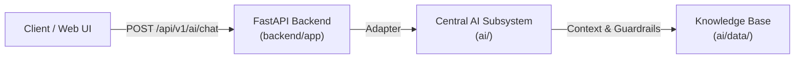

# SBU TECH — Central AI & RAG Subsystem

The root-level `ai/` directory is the single, centralized workspace for all SBU TECH artificial intelligence, retrieval-augmented generation (RAG), vector stores, datasets, model configurations, and local LLM workflows.

---

## 1. Directory Architecture

```text
ai/
├── SBU_TECH.pdf                 # Original company source knowledge-base PDF (read-only)
├── README.md                    # Subsystem documentation & usage guide
├── requirements.txt             # AI-specific Python dependencies
├── .gitignore                   # Ignores model weights, local Qdrant databases, caches, logs
├── run_pipeline.py              # Convenience root pipeline runner
│
├── config/                      # Centralized configuration & path resolvers
│   ├── __init__.py
│   └── settings.py              # Pydantic settings: paths, token boundaries, model configurations
│
├── data/                        # Processed datasets, chunks, and metadata
│   ├── raw/                     # Original raw document snapshots
│   ├── extracted/               # Raw extracted text & parsed tables (raw_extracted.json)
│   ├── cleaned/                 # Cleaned text with stripped headers (cleaned_text.txt)
│   ├── chunks/                  # Semantic chunks (chunks.jsonl & chunks.csv)
│   ├── evaluation/              # Benchmark question-answer ground truth datasets
│   ├── manifest.json            # Pipeline run metrics, document SHA-256, timestamps
│   └── review_report.md         # Audit report of placeholders, missing sections & cautions
│
├── ingestion/                   # Phase 1: Local PDF extraction & preprocessing pipeline
│   ├── __init__.py
│   ├── pdf_extractor.py         # PyMuPDF text & table extraction, page validation
│   ├── cleaner.py               # Running header stripping, table markdown formatting, caution detection
│   ├── chunker.py               # Structure-aware chunking (350–500 tokens, 50–80 overlap, Q&A preservation)
│   └── pipeline.py              # Master idempotent ingestion pipeline orchestrator
│
├── embeddings/                  # Phase 2: Multilingual embedding models (Prepared)
│   ├── __init__.py
│   ├── model.py                 # Interface for BAAI/bge-m3 dense & sparse embeddings
│   └── generator.py             # Batch vector generation from chunks.jsonl
│
├── vectorstore/                 # Phase 2: Vector database connectors (Prepared)
│   ├── __init__.py
│   ├── qdrant_client.py         # Local / persistent Qdrant collection connector
│   └── indexer.py               # Vector upsert and payload indexing
│
├── retrieval/                   # Phase 3: Semantic & hybrid search (Prepared)
│   ├── __init__.py
│   ├── semantic_search.py       # Dense + sparse hybrid search engine
│   └── retriever.py             # RAG context assembler with page citations
│
├── llm/                         # Phase 4: Local LLM inference (Prepared)
│   ├── __init__.py
│   ├── model_loader.py          # Local quantized model loader (Llama-3-8B / Mistral)
│   └── generator.py             # Hallucination-free answer generator
│
├── prompts/                     # Prompt templates & guardrails
│   ├── __init__.py
│   └── system_prompts.py        # System prompt with company invariants (Knowledge Base Section 9)
│
├── evaluation/                  # Phase 7: Evaluation benchmarks
│   └── __init__.py              # Faithfulness, answer relevance, latency benchmarks
│
├── models/                      # Local storage for downloaded model checkpoints (.gitignore)
│   └── .gitkeep
│
├── storage/                     # Persistent local storage for vector database
│   └── qdrant/                  # Local Qdrant binary data (.gitignore)
│       └── .gitkeep
│
├── scripts/                     # Operational CLI scripts
│   ├── __init__.py
│   └── run_ingestion.py         # Phase 1 CLI pipeline runner
│
├── tests/                       # Unit and integration test suites
│   ├── __init__.py
│   └── test_ingestion.py        # Automated acceptance tests for Phase 1
│
└── logs/                        # Subsystem runtime logs (.gitignore)
    └── .gitkeep
```

---

## 2. Requirements & Installation

Dependencies for the AI subsystem are defined in `ai/requirements.txt`:

```bash
# From workspace root:
pip install -r ai/requirements.txt
```

Current Phase 1 runtime requirements:
- `pymupdf>=1.23.0`: Local PDF extraction, layout parsing, and table discovery.
- `tiktoken>=0.7.0`: Fast `cl100k_base` tokenization with local fallback.
- `pydantic>=2.0.0` & `pydantic-settings>=2.0.0`: Type-safe path and setting resolution.

---

## 3. How to Run AI Tasks

All scripts can be executed directly from the project root:

### Ingest & Process Knowledge Base (Phase 1):
```bash
# Convenience entry point:
python ai/run_pipeline.py

# Or via the scripts module:
python ai/scripts/run_ingestion.py
```

### Run the AI Automated Test Suite:
```bash
python ai/tests/test_ingestion.py
```

---

## 4. Output Storage in `ai/data/`

All generated processing deliverables are safely written inside `ai/data/`:

| Artifact | Location | Description |
| :--- | :--- | :--- |
| **`raw_extracted.json`** | `ai/data/extracted/` | Raw text, page character counts, and extracted table matrices |
| **`cleaned_text.txt`** | `ai/data/cleaned/` | Consolidated clean text with running headers removed |
| **`chunks.jsonl`** | `ai/data/chunks/` | Semantic chunks with token metrics, source file, page, and section |
| **`chunks.csv`** | `ai/data/chunks/` | Spreadsheet-ready summary of chunks for editorial review |
| **`manifest.json`** | `ai/data/` | Run metadata, document SHA-256, page/token metrics, timestamps |
| **`review_report.md`** | `ai/data/` | Audit report of unconfirmed claims, placeholders, and structural gaps |

---

## 5. FastAPI Backend Integration

The backend (`backend/app/api/v1/endpoints/ai.py`) interacts with this subsystem through the adapter in `backend/app/rag/assistant.py`:



- **No duplicate AI logic** lives inside `backend/`.
- The backend delegates query handling and document references to `ai/`.

---

## 6. Multi-Phase Roadmap

- [x] **Phase 1: PDF Ingestion & Structure-Aware Chunking** (Complete & Active)
- [ ] **Phase 2: Multilingual Embeddings & Vector Store** (`BAAI/bge-m3` + local Qdrant)
- [ ] **Phase 3: Semantic & Hybrid Retrieval** (Dense + BM25 keyword search)
- [ ] **Phase 4: Local Quantized LLM Inference** (Local answer generation)
- [ ] **Phase 5: FastAPI High-Throughput Endpoint Integration**
- [ ] **Phase 6: Website Chatbot Frontend Integration**
- [ ] **Phase 7: Automated Evaluation Benchmarks & Guardrail Verification**

